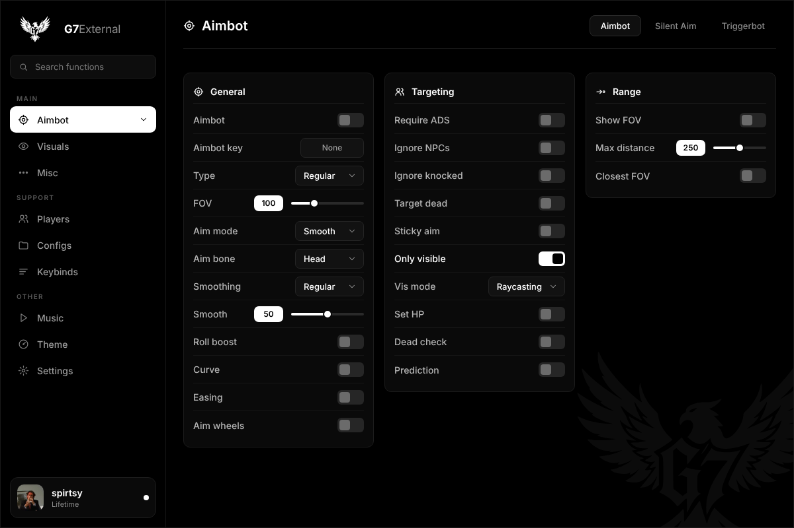

# G7External – Figma menu kit

Black-and-white menu UI for **G7External**, delivered as a free Figma development plugin that
builds the whole thing into your file as a clickable prototype.

## Run it (free, any Figma plan)

1. Open Figma desktop and open a **new blank design file** (or the existing G7External file; the
   plugin adds its own pages and does not touch anything else).
2. Menu → **Plugins → Development → Import plugin from manifest…** and pick
   `g7external-figma/plugin/manifest.json`.
3. Menu → **Plugins → Development → G7External Builder**. It runs for a few seconds and ends on
   the `G7 · Screens` page.
4. Press **Present** (the play button, top right) to click through the menu.

Running it again adds a second set of pages, so delete the old `G7 ·` pages first if you re-run.

## What you can click in Present mode

- **Channels** in the sidebar (Aimbot, Visuals, Misc, Players, Configs, Keybinds, Music, Theme,
  Settings) and every **tab** in the header navigate between the 23 screens.
- **Toggles** flip on click (animated).
- **Dropdowns** open a menu on click; clicking an option closes it. Each dropdown shows its own
  options.
- **Key buttons** cycle None → "Press a key" → F → None.
- **Keybind mode chips** cycle N/A → Hold → Toggle.
- **Sliders** step through 0 / 25 / 50 / 75 / 100 on click.
- The **profile card** (Bateman avatar, bottom left) opens the account popover; clicking it again
  closes it.

Search fields are visual only: Figma prototypes cannot take typed input.

## Pages the plugin creates

- `G7 · Screens` – 23 screens: Aimbot ×3, Visuals ×2, Misc ×6, Players, Configs ×3, Keybinds,
  Music, Theme ×4, Settings ×2. Prototype flow starts on Aimbot.
- `G7 · Components` – Logo mark and watermark, Toggle, Dropdown, Key Button, Keybind Mode Chip,
  Slider (all interactive), Badge, Color Swatch, Button, Search Field, User Card, Nav Item, Tab,
  and a 31-icon sheet.
- `G7 · Brand` – logo on black and on white, wordmark, palette (also saved as `G7/…` paint
  styles) and type scale.

## Look

Pure black background. Left sidebar with the eagle mark and `G7External` wordmark, the active
channel inverted to a white block, quiet pill tabs on the right of the page title, hairline panels
in `#0A0A0A`, and a faint eagle watermark behind the content. Inter throughout.

| Token | Hex |
|-------|-----|
| Background | `#000000` |
| Panel | `#0A0A0A` |
| Raised | `#111111` |
| Control | `#121212` / border `#242424` |
| Hairline | `#161616` / `#1C1C1C` |
| Text muted / secondary / primary | `#6B6B6B` / `#8A8A8A` / `#FFFFFF` |

`preview/logo-white.svg` is the traced vector eagle used by the plugin.
